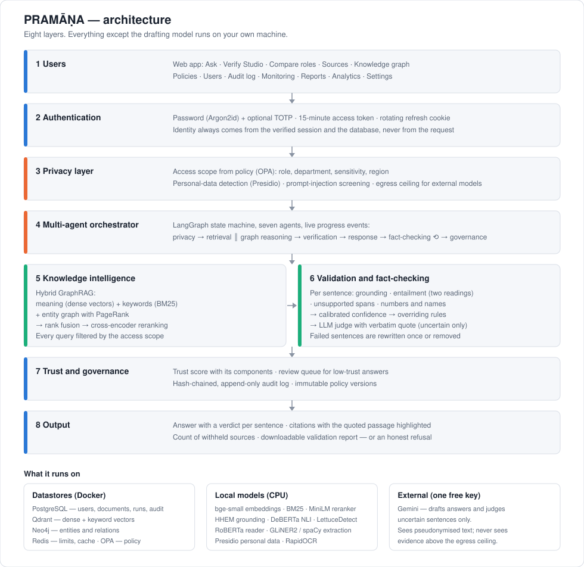
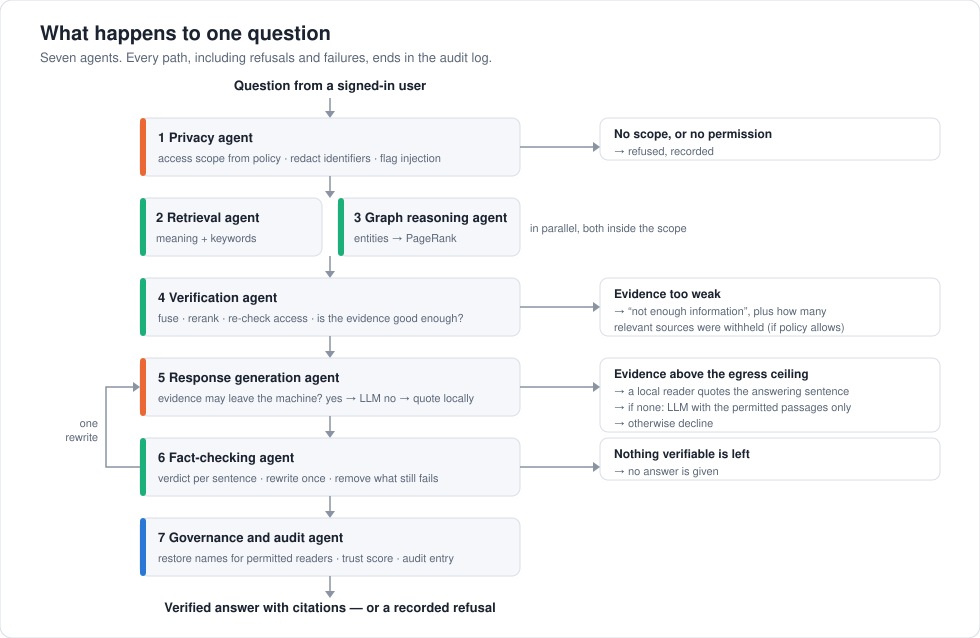
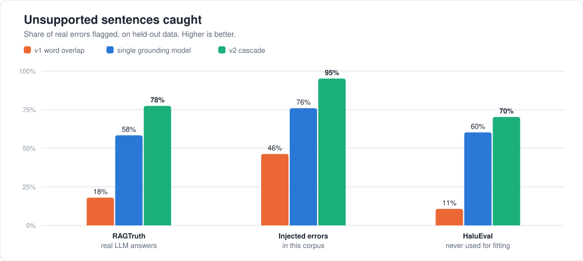
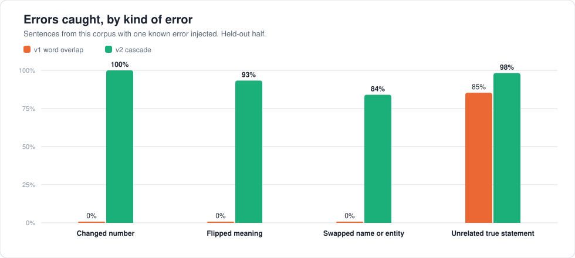

# PRAMĀṆA

**Privacy-aware enterprise knowledge intelligence.** Ask a question over your
organisation's documents and get an answer in which every sentence has been checked
against a source you are allowed to read — or no answer at all.

*Pramāṇa* (Sanskrit): a means of valid knowledge; proof.

**Contents:** [What it is](#what-it-is) · [Why](#why-it-exists) · [How it works](#how-it-works) ·
[Results](#measured-results) · [What you can do](#what-you-can-do-with-it) ·
[Technology](#technology-and-why-each-piece-was-chosen) · [Run it](#quick-start) ·
[Your own data](#testing-with-your-own-data) · [Limits](#limits) · [Documentation](#documentation)

---

## What it is

A company's knowledge lives in policies, contracts, reports and e-mail. An AI assistant
over those documents is useful only if three things hold, and an ordinary
"chat with your documents" tool guarantees none of them:

| The question a company asks | What PRAMĀṆA does |
|---|---|
| *Will it show someone a document they are not allowed to read?* | Role, department, sensitivity and region decide what each person can retrieve. The rule is enforced inside every database query and checked again afterwards |
| *Will it make things up?* | Every sentence of an answer is checked against the evidence by local models. Sentences that fail are rewritten once or removed. With weak evidence it says so instead of answering |
| *Will our confidential data be sent to an AI company?* | Personal data is replaced by placeholders before any prompt. Restricted documents are never sent at all: a local model quotes the answering sentence |
| *Can we prove afterwards what it did?* | Every request leaves an entry in an append-only, hash-chained audit log, with the policy version that decided it |

It also works as a **checker for text written elsewhere**: paste the output of any AI
tool into *Verify Studio* and each sentence is marked supported, unsupported or
contradicted, with the passage it was measured against.

## Why it exists

The first version of this project was built for a hackathon. It had the right idea and
the right diagram, but underneath it the search returned a fixed passage, the knowledge
graph was a hard-coded list, the "fact-checker" counted shared words, the user's
clearance level was read from the request itself, and the evaluation printed fixed
numbers. It asked for five to seven API keys and used one.

Version 2 keeps the idea and replaces the implementation. Three rules guided it:

1. **Measure, don't claim.** Every number in this document comes from a stored
   evaluation run that you can repeat. Targets that were missed are shown as missed.
2. **Keep it local.** Search, verification, personal-data detection and OCR all run
   on a laptop CPU. One free API key is needed, for drafting answers.
3. **Refusing is a valid answer.** A wrong answer or a leaked document costs more than
   "the sources you can access do not contain this".

## How it works



The eight layers, in the order a question passes through them:

1. **Users** — a web app with twelve screens (listed [below](#what-you-can-do-with-it)).
2. **Authentication** — password with optional authenticator-app code. Who you are is
   taken from the verified session and the database, never from what the request says.
3. **Privacy layer** — the policy engine turns your role, department and region into an
   *access scope*. Identifiers in the question are redacted; attempts to instruct the
   system ("ignore previous instructions…") are flagged.
4. **Multi-agent orchestrator** — seven agents with a fixed order, one bounded
   correction loop, and a rule that every path ends in the audit log.
5. **Knowledge intelligence** — three searches run inside your scope: by meaning, by
   keywords, and through a graph of entities. Their results are fused and reranked.
6. **Validation** — each sentence of the draft is checked: is it grounded, is it
   entailed, are its numbers and names in the source? A trained model turns the signals
   into one confidence value; hard rules override it where the evidence is clear.
7. **Trust and governance** — a trust score with its components, a review queue for
   weak answers, the audit entry.
8. **Output** — the answer with a verdict per sentence and the quoted passages, or a
   refusal that says why.



Three design choices do most of the work:

* **Access is a filter, not a check.** Asking "may this user read this document?" once
  per document cannot be applied inside a vector search. Instead the policy returns a
  scope, and the scope is compiled into the query of each datastore (Qdrant, Neo4j,
  Postgres). Documents outside it are never candidates.
* **Small verifiers, not one big judge.** An LLM checking an LLM is slow and shares its
  blind spots. Four small local models plus literal checks are fast and independent;
  the LLM is asked only about sentences the local models are unsure of, and must
  return a verbatim quote that is then checked.
* **An egress ceiling.** Evidence above a configured sensitivity is never put in a
  prompt. A local reading model finds the answering sentence and quotes it. It can
  also find *no* answer, in which case nothing is quoted.

More detail: [docs/ARCHITECTURE.md](docs/ARCHITECTURE.md). The reasoning behind each
choice, including what was tried and rejected: [docs/DECISIONS.md](docs/DECISIONS.md).

## Measured results

> **Read this first.** The figures in the first table below come from questions written
> alongside the system. Two blind tests — unseen documents, questions written
> independently — are the ones to believe: **51 %** of answerable questions correct on the
> first; after the causes were fixed, **72 %** on a second, different one (plain facts and
> table lookups 24 of 24, questions chaining two documents 6 of 16). In both: **no leaks,
> no invented facts**. Details: [docs/BLIND_TEST.md](docs/BLIND_TEST.md).

Measured on this repository's code on a laptop CPU (i7-1360P, 16 GB RAM, no GPU).
Full report with method and caveats: [docs/RESULTS.md](docs/RESULTS.md).

### The whole pipeline — 65 questions written alongside the system, over 1,744 documents

| | Result | Target |
|---|---|---|
| Answerable questions answered correctly | **53 of 55** (96.4 %) — 0 wrong, 2 declined | ≥ 85 % |
| Unanswerable questions declined | **10 of 10** | ≥ 80 % |
| Sentences in final answers that are verified | 95.1 % | ≥ 95 % |
| Restricted facts leaked to roles without access | **0** | 0 |
| Median response time | 6.1 s (95th percentile 13.7 s) | ≤ 10 s |

### Access control — 28 planted facts, asked as every role

**149 unauthorised attempts, 0 leaks.** All 47 authorised lookups found the fact.

### Does the verifier catch unsupported sentences?



| Benchmark (held out) | v1 | Single model | **v2** | v2 false alarms |
|---|---|---|---|---|
| RAGTruth — human-annotated errors in real LLM answers | 18.0 % | 58.4 % | **77.5 %** | 14.0 % |
| Injected errors in this corpus | 46.3 % | 76.0 % | **95.2 %** | 0.0 % |
| HaluEval — never used for fitting | 10.7 % | 60.3 % | **70.3 %** | 18.5 % |

"v1" is the word-overlap check of the first version, reproduced on the same sentences.



### Retrieval — is the passage with the answer among the top 8?

**100 %** of the time with the full pipeline, at rank 1 in 96 % of cases (MRR 0.977).

### What these numbers do not show

* About one correct sentence in seven is flagged on RAGTruth. In the answer pipeline a
  flagged sentence gets a second opinion; in Verify Studio the reader sees the passage.
* One target set before measuring was missed: answer-level F1 on RAGTruth is 0.50
  against 0.70. It is left in place and shown as not met.
* The 65 questions were written for the synthetic company documents by the same
  process that built the system. They show the pipeline works end to end, not how it
  will perform on your documents — see [Testing with your own data](#testing-with-your-own-data).

## What you can do with it

| Screen | Purpose |
|---|---|
| **Ask** | Question → live view of the seven agents → answer with per-sentence verdicts, citations with highlighted quotes, trust score, reasoning, policy decision, downloadable report |
| **Verify Studio** | Paste any text — from this or any other tool — and check it sentence by sentence against the knowledge base or a reference you paste |
| **Compare roles** | The same question as two people, side by side. You can preview only as someone whose access lies within your own |
| **Sources** | Upload (PDF, DOCX, PPTX, Markdown, HTML, text, e-mail; scanned PDFs and images via local OCR), suggested sensitivity, ingestion progress, passages with personal data masked |
| **Knowledge graph** | Explore entities and relations extracted from the documents you can read |
| **Policies** | Role limits, egress ceiling, simulator ("what can this user see, and why?"), version history |
| **Users** | Accounts, roles, departments, regions, MFA status |
| **Audit** | Every decision, filterable; one-click verification of the hash chain |
| **Monitoring** | Datastore health, model status, LLM usage, time per agent |
| **Reports / Analytics** | Verdict distribution, review queue, benchmark runs with pass/fail gates; usage and trust over time |
| **Settings** | Profile, theme, MFA enrolment with recovery codes, sessions |

A guided tour, checked against the running system: [docs/DEMO.md](docs/DEMO.md).

## Technology, and why each piece was chosen

| Part | Technology | Why |
|---|---|---|
| API | FastAPI, one service with ten modules | seven "agents" do not need seven services; modules keep the boundaries without the network hops |
| Orchestration | LangGraph | parallel branches, a bounded loop and "every path ends in the audit" are explicit and testable |
| Access policy | Open Policy Agent (Rego) | policy as code, unit-tested, versioned; returns a scope that becomes a query filter |
| Vector search | Qdrant | dense and keyword vectors in one collection, filtered inside the search |
| Graph | Neo4j Community | real traversals with an access predicate on every hop |
| Records | PostgreSQL | users, documents, runs, claims, audit log, policy versions, job queue |
| Limits and cache | Redis | rate limits, LLM response cache, provider cool-downs |
| Embeddings, reranker | bge-small, BM25, MiniLM cross-encoder (ONNX) | fast on CPU, no key, no cost per query |
| Verification | HHEM, DeBERTa-v3 NLI, LettuceDetect, a trained logistic calibrator | independent small models; calibrated so that 0.8 means about 80 % |
| Quoting restricted material | RoBERTa reader (SQuAD 2.0) | finds the answering words, and knows when there are none |
| Personal data | Presidio + spaCy | detection, masking and reversible placeholders |
| OCR | RapidOCR (ONNX) | scanned pages and images, 15 MB, local |
| Drafting | Gemini free tier over plain HTTP | the only external dependency; optional fallbacks: Groq, Cerebras, a local Ollama model |
| Web app | Next.js, React, Tailwind | twelve screens, light and dark |

## Quick start

Requirements: Docker Desktop, Python 3.12 with [uv](https://docs.astral.sh/uv/),
Node.js 20+, 16 GB RAM. No GPU.

```bash
python scripts/init_env.py            # creates .env; put your GOOGLE_API_KEY in it
docker compose up -d --wait           # Postgres, Redis, Qdrant, Neo4j, OPA
cd backend && uv sync && uv run alembic upgrade head && cd ..
python scripts/seed.py                # roles, demo personas, first policy version
python scripts/download_models.py     # local models, about 2 GB, once
python scripts/fetch_data.py          # free public corpora
python scripts/generate_synthetic.py  # the fictional company's confidential documents
python scripts/ingest_corpus.py       # index everything (1–2 hours on CPU)
```

Then, in two terminals:

```bash
cd backend && uv run uvicorn pramana.api.app:app --port 8000
```

```bash
cd frontend && npm ci && npm run build && npm run start
```

Open http://localhost:3000 and sign in as a demo persona (password: `DEMO_PASSWORD` in
`.env`). Operations and troubleshooting: [docs/RUNBOOK.md](docs/RUNBOOK.md).

### Keys

| Key | Required | Used for |
|---|---|---|
| `GOOGLE_API_KEY` | **yes** | drafting answers and judging uncertain sentences (Gemini free tier) |
| `GROQ_API_KEY`, `CEREBRAS_API_KEY` | no | extra capacity when the free quota runs out |
| `OLLAMA_BASE_URL` | no | a local model instead of, or after, the hosted ones |

Every other secret in `.env` is generated locally by `scripts/init_env.py`.

### Data that ships with the demo

| Collection | Source | Use |
|---|---|---|
| Handbook | GitLab Handbook (450 pages) | public and internal policy text |
| Regulations | GDPR, India DPDP Act, HIPAA Part 164, Sarbanes-Oxley, NIST CSF 2.0, NIST AI RMF, NIST SP 800-171 | compliance questions |
| Contracts | CUAD (49 contracts) | long legal documents |
| E-mail | Enron corpus sample (1,099 messages) | messy real correspondence |
| Aurelia Systems | generated by `scripts/generate_synthetic.py` | confidential material no company publishes: pay bands, board minutes, an acquisition memo, an incident report |
| RAGTruth, HaluEval | public benchmarks | training and testing the verifier (not ingested) |

All of it is downloaded or generated by the scripts; nothing has to be collected by hand.

## Testing with your own data

The demo proves the machinery. The real test is your documents and your questions.
[docs/TEST_DATA.md](docs/TEST_DATA.md) explains what kind of data tests which part of
the system, where to get it free, and how to load it:

* a few documents — **Sources → Upload** in the web app;
* a folder — put the files and a `manifest.jsonl` in `data/custom/` and run
  `python scripts/ingest_corpus.py --collections custom`;
* your own questions — `python scripts/run_eval.py --suites end_to_end --golden my-questions.jsonl`.

## Repository

```
backend/     FastAPI service (src/pramana), migrations, 140 tests
frontend/    Next.js web app
policies/    Access policy (Rego) and its tests
scripts/     Setup, data, ingestion, training, evaluation and figure commands
eval/        Golden questions for the demo tenant
docs/        Architecture, decisions, results, test data, runbook, demo walkthrough
compose.yaml Datastores; `--profile app` adds the API, worker and web app
```

Quality checks:

```bash
cd backend && uv run ruff check src tests ../scripts && uv run mypy && uv run pytest
cd frontend && npx tsc --noEmit && npx eslint src && npm run build
```

## Limits

* On unseen documents the system answers about 72 % of answerable questions (second blind
  test). Questions that chain two documents mostly stop at the first step, and "my
  division" questions fail unless the organisation's names for its regions are known.
  See [docs/BLIND_TEST.md](docs/BLIND_TEST.md).
* The verifier is good, not perfect: on real LLM answers it misses about one error in
  four and flags about one correct sentence in seven. A swapped name is the hardest
  error for it (84 % caught).
* Scanned pages are read by a small OCR model, tested only on clean printed pages;
  tables in scans lose their structure.
* English only: the local models are English models.
* Answers from restricted material are a quoted sentence: they do not combine passages,
  and a question whose answer sits in a restricted table is declined.
* An administrator can change the policy, including the limits of their own role. The
  change is recorded in the audit log but not blocked; a production deployment should
  require a second approver.
* The free LLM tier is rate-limited; its exact quota was not measured. The longest run
  here made 50 calls in about ten minutes without being throttled.
* Built and measured on one laptop; not load-tested. Both container images build, but
  the full `--profile app` stack and the CI workflow have not been run: the development
  machine had no memory left for the former and the repository has no remote for the
  latter.

## Documentation

| Document | What it answers |
|---|---|
| [docs/ARCHITECTURE.md](docs/ARCHITECTURE.md) | How each layer works: access control, privacy, retrieval, validation, governance |
| [docs/DECISIONS.md](docs/DECISIONS.md) | Why each choice was made, what was tried and rejected, where the build departs from the plan |
| [docs/RESULTS.md](docs/RESULTS.md) | Every measurement, how it was made, how to repeat it, and what it does not show |
| [docs/BLIND_TEST.md](docs/BLIND_TEST.md) | What happened on unseen documents with independently written questions — the figures to believe |
| [docs/TEST_DATA.md](docs/TEST_DATA.md) | What data to test with, where to find it, how to load it and write questions for it |
| [docs/DEMO.md](docs/DEMO.md) | A guided tour with the demo personas |
| [docs/RUNBOOK.md](docs/RUNBOOK.md) | Setup, start and stop, training, operations, troubleshooting |
